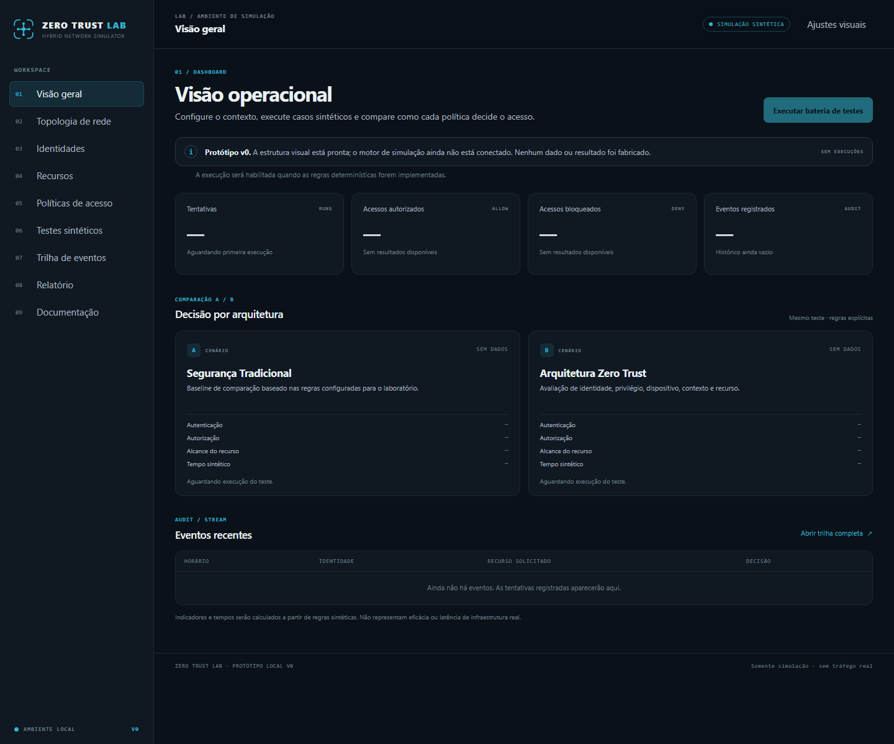

# ZERO TRUST LAB

**Hybrid Network Security Simulator**

O ZERO TRUST LAB é um projeto acadêmico para demonstrar, por meio de regras configuráveis e casos sintéticos, diferenças entre uma baseline de segurança baseada em perímetro e decisões de acesso inspiradas em Zero Trust.

> **Estado atual:** v0 visual em revisão. O motor de simulação, métricas, exportações e workflow de publicação ainda serão implementados.

## Limites do laboratório

O projeto será exclusivamente um simulador no navegador. Não fará varreduras, autenticações, exploração de vulnerabilidades, comunicação com equipamentos nem alterações em infraestrutura real. Usuários, IPs, dispositivos, recursos e eventos serão fictícios. Tempos e indicadores serão explicitamente sintéticos e não representarão medições reais.

## Estrutura inicial

A aplicação ficará em `site/`; os módulos de lógica, documentação, testes e workflow serão acrescentados nas etapas seguintes. O diretório `site/` será o único conteúdo destinado ao GitHub Pages.

## Execução local do v0

Abra `site/index.html` em um navegador moderno. Nesta etapa, o protótipo usa apenas arquivos locais de HTML, CSS e JavaScript. Os controles de navegação e ajustes visuais funcionam; os módulos de simulação aparecem como placeholders.

## Captura da interface

A imagem mostra o dashboard v0 sem execuções e sem métricas inventadas. Ela documenta a estrutura visual, não resultados experimentais.

## GitHub Pages

A publicação automática ainda não está configurada. O deploy será preparado para o repositório existente `jadirrod/Projeto_Integrador`, sem renomeá-lo. O endereço público será registrado após configurar e confirmar o GitHub Pages.

## Licença

Licença ainda não escolhida pelo autor; nenhum arquivo de licença foi criado nesta etapa.
